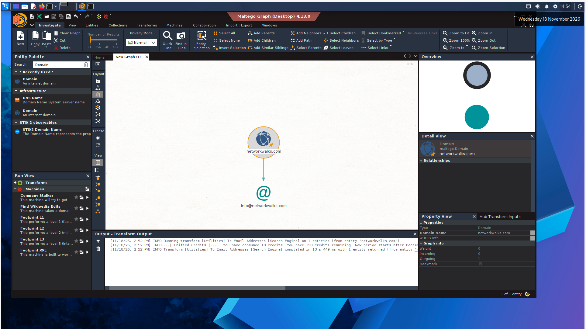
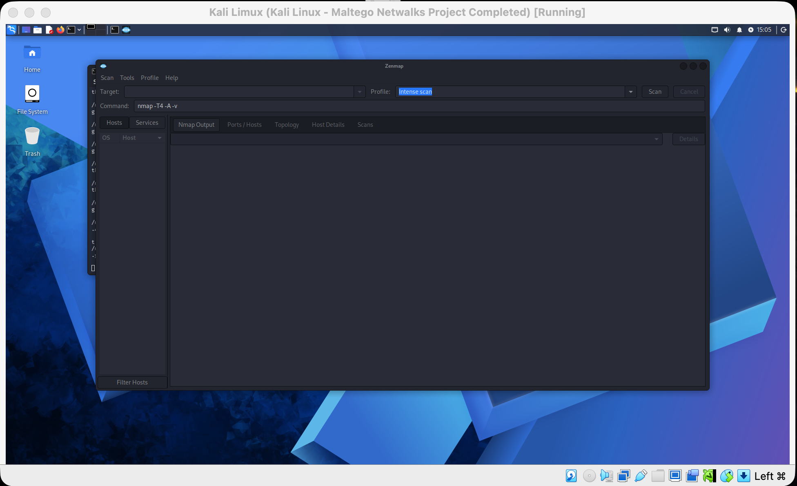
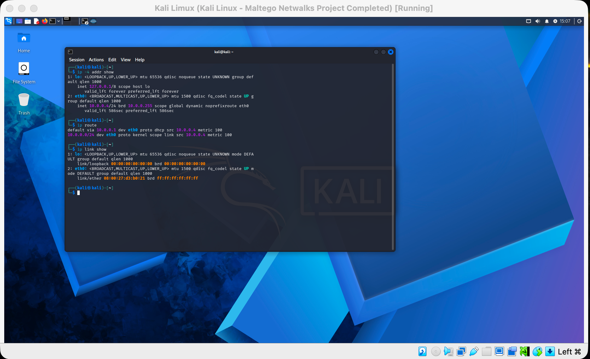
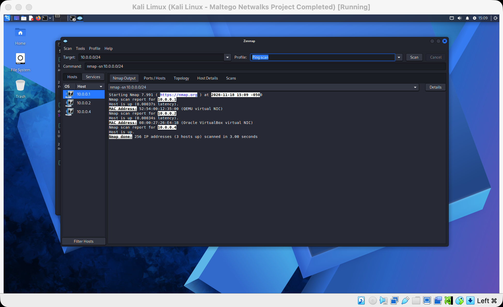
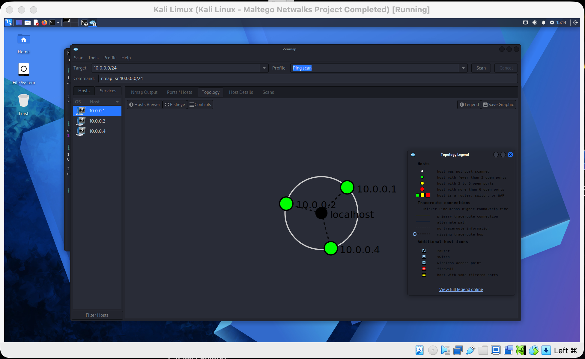
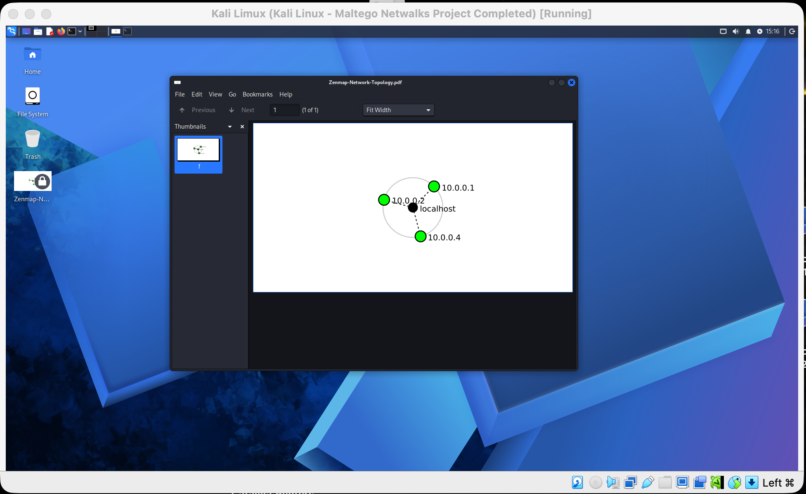

# NETWORKWALKS-B084-WK2-MALTEGO-AND-ZENMAP-PROJECTS

# PENETRATION TESTING REPORT
### Footprinting & Network Scanning Phases

**W2-PM-FINAL | CYBERSECURITY | NETWORKWALKS**

| Field | Details |
|---|---|
| Pentester Name | Aamir Taariq |
| Program / Batch | B084 - NetworkWalks |
| Date | November 18, 2026 |
| Module 1 | W2-PM3 - Footprinting with Maltego |
| Module 2 | W2-PM5 - Network Scanning with Zenmap |
| Client / Target | NetworkWalks and my VirtualBox lab network |
| Written Client Authorization | Pending verification |
| Phases Covered | Phase 1 and Phase 2 |
| Project Status | Practical tasks completed |

# 1. Liability Disclaimer

This project was conducted for educational purposes as part of my cybersecurity internship at NetworkWalks. Security testing must remain limited to personally controlled systems and systems for which explicit authorization has been obtained.

No exploitation, unauthorized access, or destructive activities were performed.

# 2. Introduction

This report documents the footprinting and network scanning activities completed during Week 2 of my NetworkWalks cybersecurity internship.

The first activity involved using Maltego to collect publicly available information associated with the NetworkWalks domain. The second activity involved using Zenmap and Nmap to identify active hosts within my virtual lab network.

Both projects were performed using Kali Linux running inside Oracle VirtualBox on an Apple Silicon MacBook Pro.

# 3. Tools Used

| Tool | Purpose |
|---|---|
| Kali Linux | Cybersecurity testing environment |
| Oracle VirtualBox | Virtualization and lab management |
| Maltego 4.13.0 | OSINT and domain footprinting |
| Nmap 7.991 | Network scanning and host discovery |
| Zenmap | Graphical interface for Nmap |
| Linux Terminal | Network configuration analysis |

# 4. Activities Performed

## 4.1 Footprinting & Reconnaissance with Maltego

I installed and configured Maltego Graph Desktop on Kali Linux to perform open-source intelligence gathering.

### Target Domain

`networkwalks.com`

### Procedure

1. Installed and configured Maltego.
2. Created a new investigation graph.
3. Added a Domain entity.
4. Entered the target domain.
5. Executed the To Email Addresses [Search Engine] transform.
6. Documented the discovered email address.

### Results

| Property | Result |
|---|---|
| Target | networkwalks.com |
| Transform | To Email Addresses [Search Engine] |
| Discovered Email | info@networkwalks.com |
| Entities Returned | 1 |
| Execution Time | 13.449 seconds |
| Credits Used | 10 |

### Evidence



## 4.2 Network Scanning with Zenmap

I installed Zenmap and Nmap on Kali Linux to perform host discovery within my VirtualBox lab network.

### Zenmap Installation

```bash
sudo apt update
sudo apt install nmap zenmap -y
sudo zenmap
```



### Network Configuration

The following commands were used to identify my local network configuration:

```bash
ip -4 addr show
ip route
ip link show
```

| Network Property | Result |
|---|---|
| Interface | eth0 |
| Local IP Address | 10.0.0.4 |
| Subnet | 10.0.0.0/24 |
| Subnet Mask | 255.255.255.0 |
| Default Gateway | 10.0.0.1 |
| Broadcast Address | 10.0.0.255 |
| MAC Address | 08:00:27:D3:B0:21 |
| IP Assignment | DHCP |



### Host Discovery

I selected the Ping Scan profile in Zenmap and executed the following command:

```bash
nmap -sn 10.0.0.0/24
```

The scan examined 256 IP addresses and discovered three active hosts in 3.00 seconds.

### Discovered Hosts

| IP Address | MAC Address | Identification |
|---|---|---|
| 10.0.0.1 | 52:54:00:12:35:00 | Default Gateway |
| 10.0.0.2 | 08:00:27:26:E4:1B | VirtualBox Network Device |
| 10.0.0.4 | 08:00:27:D3:B0:21 | Kali Linux VM |

The Kali Linux MAC address was obtained through the Linux terminal. The exact function of 10.0.0.2 was not independently verified.



### Network Topology

After completing the scan, I opened the Topology tab, enabled the legend, adjusted the zoom level, and exported the network topology as a PDF.



### PDF Verification

I opened the exported PDF to verify that the network topology was saved correctly.



# 5. Risk Analysis / Impact

| Finding | Potential Impact | Risk Level |
|---|---|---|
| Publicly available email address | Could assist targeted phishing or social engineering | Low |
| Locally discoverable hosts | Provides information for further network reconnaissance | Low |
| Visible MAC addresses | May assist local device identification | Low |
| Unverified network device | Device should be compared against the expected asset inventory | Low |

These findings represent reconnaissance observations rather than confirmed vulnerabilities.

No port scanning, exploitation, or vulnerability validation was performed during these exercises.

# 6. Recommendations

- Regularly review publicly exposed organizational information.
- Implement phishing-resistant multifactor authentication.
- Conduct security awareness training.
- Perform periodic authorized network discovery.
- Investigate unexpected network devices.
- Maintain an updated network asset inventory.
- Implement appropriate network segmentation.
- Conduct cybersecurity testing only within an authorized scope.

# 7. Conclusion

During Week 2 of my NetworkWalks cybersecurity internship, I successfully completed practical exercises involving footprinting, reconnaissance, network scanning, and host discovery.

Using Maltego, I identified publicly available information associated with the target domain. Using Zenmap and Nmap, I identified three active hosts, documented their IP and MAC addresses, and generated a network topology.

These exercises strengthened my understanding of OSINT, network security, asset discovery, technical documentation, and ethical hacking methodologies.

# 8. Evidence Collected

All supporting screenshots are stored in the screenshots folder.

## Project Reports

- [Week 2 Penetration Testing Report](reports/Week_2_Penetration_Testing_Report_B084.pdf)
- [Zenmap Network Topology](reports/Zenmap-Network-Topology.pdf)

---

## Skills Demonstrated

- Open-Source Intelligence (OSINT)
- Footprinting and Reconnaissance
- Network Scanning
- Network Asset Discovery
- IP and MAC Address Analysis
- Network Topology Mapping
- Linux Administration
- Virtualization
- Cybersecurity Risk Analysis
- Technical Report Writing

## Author

**Aamir Taariq**

Cybersecurity Intern | Batch B084

M.S. Cybersecurity Intelligence and Information Security

University of South Florida

## Project Information

**Program:** NetworkWalks Cybersecurity Internship

**Week:** 02

**Modules:** W2-PM3 & W2-PM5

**Reference:** [NetworkWalks Sample Repository](https://github.com/waqaskarimccie/Pentesting-Report-Sample)
